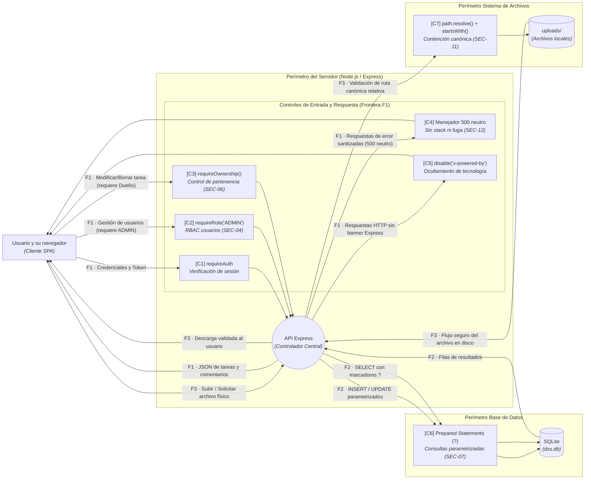

# Diagrama de Flujo de Datos (DFD) con Controles de Seguridad · DSS

Diagrama de Flujo de Datos que modela las tres fronteras de interacción del sistema, sus flujos y los **controles de seguridad implementados** para mitigar las amenazas identificadas.

---

## 1. Diagrama DFD con Fronteras y Controles

---

## 2. Matriz de Controles de Seguridad por Frontera

| Frontera | Código Control | Control de Seguridad Implementado | Hallazgo Mitigado | Archivo de Implementación | Comportamiento Seguro |
| :--- | :---: | :--- | :---: | :--- | :--- |
| **F1** *(Cliente $\leftrightarrow$ API)* | **C1** | Autenticación obligatoria con `requireAuth` | N/A | `server/src/middleware/auth.js` | Rechaza peticiones sin cabecera `Authorization` con `401 Unauthorized`. |
| **F1** *(Cliente $\leftrightarrow$ API)* | **C2** | Control de acceso basado en roles con `requireRole('ADMIN')` | **SEC-04** *(CWE-285)* | `server/src/routes/users.routes.js:13` | Alumnos no pueden listar ni crear usuarios; responde `403 Forbidden`. |
| **F1** *(Cliente $\leftrightarrow$ API)* | **C3** | Control de pertenencia a objetos con `requireOwnership(cargarTarea)` | **SEC-06** *(CWE-639)* | `server/src/routes/tasks.routes.js:54,71` | Impide que un usuario modifique o elimine recursos de otros; responde `403 Forbidden`. |
| **F1** *(Cliente $\leftrightarrow$ API)* | **C4** | Manejo global de errores 500 sanitizado | **SEC-12** *(CWE-209)* | `server/src/app.js:36-39` | Envía `err.stack` únicamente a la consola del servidor y responde al cliente `{"error": "Error interno"}`. |
| **F1** *(Cliente $\leftrightarrow$ API)* | **C5** | Supresión de cabecera de fingerprinting | **SEC-12** *(CWE-200)* | `server/src/app.js:10` | Ejecuta `app.disable('x-powered-by')` para no revelar la tecnología del servidor. |
| **F2** *(API $\leftrightarrow$ SQLite)* | **C6** | Consultas SQL parametrizadas con marcadores de posición `?` | **SEC-07** *(CWE-89)* | `server/src/routes/tasks.routes.js:28-31` | `db.prepare(...).all(patron, patron)` separa la sintaxis SQL de los datos del usuario, neutralizando inyecciones. |
| **F3** *(API $\leftrightarrow$ uploads/)* | **C7** | Normalización canónica de ruta con `path.resolve` y verificación `startsWith` | **SEC-11** *(CWE-22)* | `server/src/routes/files.routes.js:40-45` | Resuelve la ruta canónica y verifica `target.startsWith(uploadRoot + sep)`; secuencias `../` son rechazadas con `404 Not Found`. |
| **Transversal** *(Entorno / Config)* | **C8** | Desacoplamiento de credenciales a `process.env` y exclusión de `.env` | **SEC-14** *(CWE-798)* | `server/src/config.js:7-13`, `.gitignore:8` | Elimina contraseñas en código duro y evita su persistencia en el repositorio Git. |
