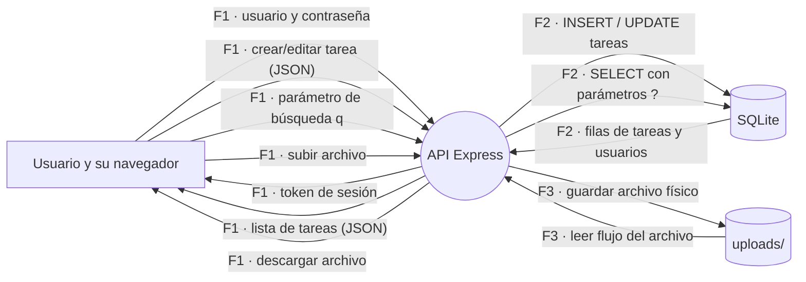

# Estado del Proyecto para la Exposición · Proyecto Final (1ª Parte)

Documento oficial de control para la **Exposición del Proyecto Final (1ª Parte)**, detallando los 6 hallazgos de seguridad mitigados frente a la versión original (`v0`), las pruebas de regresión automatizadas y la **deuda técnica formalmente declarada** para la siguiente etapa.

---

## 1. Los Seis Hallazgos Cerrados (Antes en v0 vs Después)

Todos cuentan con pruebas automatizadas en `server/tests/` que pasan en verde en la suite de CI/CD:

| ID | Vulnerabilidad / Debilidad | Estado | Comportamiento en v0 (Antes) | Comportamiento Protegido (Después) | Prueba de Regresión |
| :--- | :--- | :---: | :--- | :--- | :--- |
| **SEC-12** | Manejo de errores y fuga de información *(CWE-209)* | **Cerrado** | HTTP 500 exponiendo `err.stack`, rutas de disco y consulta SQL interna | HTTP 500 respondiendo únicamente `{"error": "Error interno"}` sin stack | [`regresion-sec12.test.js`](file:///c:/Users/joeld/Downloads/CodigoSeguro/dss-proyecto-base/server/tests/regresion-sec12.test.js) |
| **SEC-06** | Modificación/borrado de recursos ajenos (IDOR) *(CWE-639)* | **Cerrado** | Un alumno borraba tareas ajenas con `DELETE /api/tasks/:id` (`204 No Content`) | Middleware `requireOwnership` valida autoría y responde `403 No autorizado` | [`sec06.test.js`](file:///c:/Users/joeld/Downloads/CodigoSeguro/dss-proyecto-base/server/tests/sec06.test.js) |
| **SEC-04** | Alumno administrando usuarios (RBAC) *(CWE-285)* | **Cerrado** | Un alumno común listaba o creaba usuarios con `GET /api/users` (`200 OK`) | Middleware `requireRole('ADMIN')` restringe el router y responde `403 No autorizado` | [`sec04.test.js`](file:///c:/Users/joeld/Downloads/CodigoSeguro/dss-proyecto-base/server/tests/sec04.test.js) |
| **SEC-07** | Inyección SQL en búsqueda de tareas *(CWE-89)* | **Cerrado** | Inyección con `q=' OR '1'='1` devolvía todas las tareas confidenciales | Consulta parametrizada con marcadores `?`, buscando texto literal (0 filas) | [`sec07.test.js`](file:///c:/Users/joeld/Downloads/CodigoSeguro/dss-proyecto-base/server/tests/sec07.test.js) |
| **SEC-11** | Path Traversal en descarga de archivos *(CWE-22)* | **Cerrado** | Petición `GET /api/files/raw?name=../src/config.js` devolvía código fuente (`200 OK`) | Normalización con `path.resolve` y verificación `startsWith`; responde `404 Not Found` | [`regresion-sec11.test.js`](file:///c:/Users/joeld/Downloads/CodigoSeguro/dss-proyecto-base/server/tests/regresion-sec11.test.js) |
| **SEC-14** | Secretos escritos en el código *(CWE-798)* | **Cerrado** | Contraseñas escritas en `config.js` y `.env` commiteado al repositorio | Secretos desacoplados a `process.env`, `.env` excluido y plantilla `.env.example` | [`regresion-sec14.test.js`](file:///c:/Users/joeld/Downloads/CodigoSeguro/dss-proyecto-base/server/tests/regresion-sec14.test.js) |

---

## 2. Deuda Técnica Declarada (Abiertos a Propósito)

Siguiendo el principio de **honestidad técnica y transparencia**, los siguientes elementos permanecen abiertos y planificados como deuda técnica para las Unidades subsiguientes:

### SEC-09 · Inyección XSS en comentarios *(CWE-79 / LFD121 Sending Output)*
* **Estado:** Demostrado en vivo / Abierto como deuda.
* **Diagnóstico:** En [`client/src/App.jsx:63`](file:///c:/Users/joeld/Downloads/CodigoSeguro/dss-proyecto-base/client/src/App.jsx#L63) los comentarios se renderizan utilizando `
`. Al enviar un comentario con ``, el navegador del usuario víctima ejecuta el script.
* **Qué falta para cerrarlo:** 
  1. En el frontend: Eliminar `dangerouslySetInnerHTML` y permitir que React renderice de forma segura como texto plano (`
{c.body}
`).
  2. Si se requiere formato enriquecido: Integrar una librería de sanitización estricta como `DOMPurify` en el renderizado.

### SEC-10 · Subida de archivos sin validación de contenido *(CWE-434 / LFD121 Input Validation)*
* **Estado:** Demostrado en vivo / Abierto como deuda.
* **Diagnóstico:** En [`server/src/routes/files.routes.js`](file:///c:/Users/joeld/Downloads/CodigoSeguro/dss-proyecto-base/server/src/routes/files.routes.js), `multer` se instanció sin `fileFilter` ni `limits.fileSize`. Permite subir cualquier archivo (ej. un `.html` renombrado a `.png` o archivos de tamaño desmedido).
* **Qué falta para cerrarlo:**
  1. Validar el tipo real mediante inspección de *Magic Bytes* (con librerías como `file-type`), rechazando archivos donde la cabecera binaria no coincida con la lista blanca.
  2. Configurar límites de tamaño estrictos en Multer (ej. máximo 5 MB por archivo).
  3. Renombrar los archivos guardados con identificadores aleatorios (UUID) sin conservar el nombre original del cliente en disco.

### El Secreto en el Historial de Git *(Deuda de Configuración / Git History)*
* **Estado:** Declarado como deuda.
* **Diagnóstico:** Aunque en el árbol de trabajo actual se eliminó `.env` y se sacaron los valores por defecto de `config.js` (SEC-14), los commits anteriores del repositorio (como `83aa671`) aún conservan las contraseñas en el historial.
* **Qué falta para atenderlo:**
  1. No se recomienda reescribir la historia de Git en repositorios colaborativos.
  2. En entornos reales de producción, la mitigación obligatoria es **rotar los secretos comprometidos** (invalidar la contraseña de correo en el servidor SMTP y generar una nueva clave criptográfica para `APP_SECRET`).

### Hallazgos pendientes para la Unidad III:
* **SEC-05:** Elevación vertical de privilegios (asignación masiva de rol en perfil).
* **SEC-02:** Token forjado en Base64 plano (migración a JWT firmado o cookies HttpOnly).
* **SEC-01:** Hashing de contraseñas con sal (actualmente en texto plano).
* **SEC-03:** Rate limiting contra ataques de fuerza bruta en login.
* **SEC-08:** Validación y sanitización estricta de esquemas de entrada (Zod / Joi).
* **SEC-13:** Configuración estricta de política de orígenes cruzados (CORS).
* **SEC-15:** Logging centralizado y auditoría de eventos de seguridad.
* **SEC-16:** Actualización de dependencias desactualizadas reportadas por `npm audit`.
* **SEC-17:** Forzar HTTPS y atributos de cookies seguras (`Secure`, `SameSite`).

---

## 3. Diagrama de Flujo de Datos (DFD) Actualizado

El flujo de datos del sistema en [`DFD.md`](file:///c:/Users/joeld/Downloads/CodigoSeguro/dss-proyecto-base/DFD.md) ya incluye las fronteras de subida y descarga de archivos físicos:

---

## 4. Verificación de la Suite de Pruebas
Todas las pruebas de regresión se encuentran en verde:
- `regresion-sec11.test.js` - Aprobada (Path Traversal prevenido)
- `regresion-sec14.test.js` - Aprobada (Secretos fuera del código)
- `regresion-sec12.test.js` - Aprobada (Manejo de errores 500)
- `sec07.test.js` - Aprobada (Inyección SQL prevenida)
- `sec06.test.js` - Aprobada (Control de pertenencia / Ownership)
- `sec04.test.js` - Aprobada (Control de acceso por roles / RBAC)
